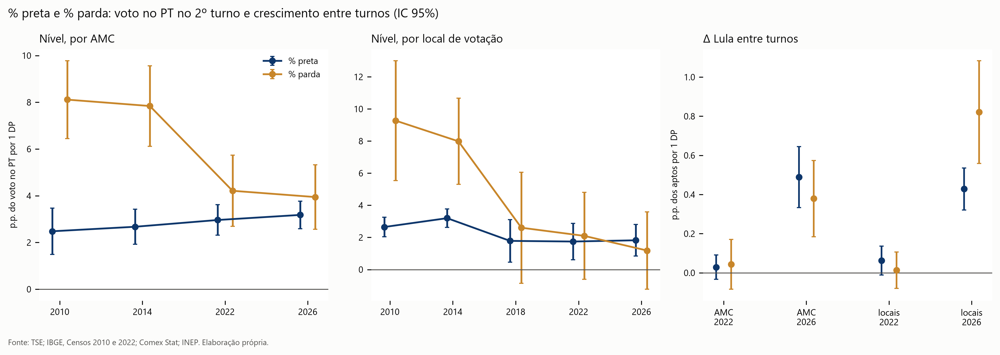
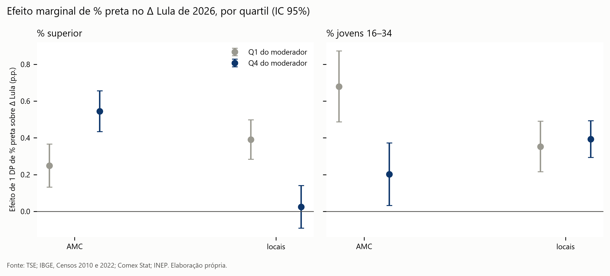

# Pretos e pardos: decompondo o efeito racial entre os turnos de 2026

Extra do pacto 2.0, a partir de `docs/planos/prompt_raca_margem.md`. Código: `src/extra_raca_entorno.py`, `src/ingest/ibge_instrucao.py` e `src/extra_raca.py`. Tabelas: `outputs/tables/extra_raca_*`. Nenhuma tabela ou modelo publicado foi alterado.

## Resumo

`extra_entre_turnos.md` mostra que a população negra elevou o crescimento de Lula entre os turnos de 2026 (+0,72 p.p. por DP), algo ausente em 2022. No nível do voto, porém, o gradiente racial do PT caiu desde 2010. A hipótese era: o efeito de 2026 vem dos pretos, sobretudo escolarizados e jovens; a queda vem dos pardos.

| Hipótese | Veredito | Evidência central |
|---|---|---|
| **R1.** No Δ de 2026, % preta > % parda; em 2022, nada | **Parcial** | Nada em 2022, confirmado. Em 2026, por p.p., % preta supera % parda nos dois níveis. Por DP, não: % parda é maior nos locais (0,82 contra 0,43). |
| **R2.** Efeito de % preta cresce com escolaridade | **Não sustentada** | Sinais opostos: +0,12 entre AMCs, −0,17 dentro das cidades. A interação entre AMCs também vale para pardos e já existia em 2022. |
| **R3.** Efeito de % preta cresce com juventude | **Não sustentada** | −0,19 entre AMCs (sinal contrário) e +0,02 dentro das cidades (nulo). |
| **R4.** A queda do gradiente vem de % parda | **Sustentada** | Entre AMCs, % parda cai de 8,1 para 3,9, e % preta sobe de 2,5 para 3,2. Dentro das cidades, 91% da queda somada vem de % parda. |

O resultado mais firme é o R4. A parte de nível da leitura proposta se sustenta; a parte sobre quem produziu o crescimento de 2026 se sustenta só em parte, e o mecanismo de escolaridade e geração não aparece nos dados.

*Figura 1. % preta e % parda no voto do PT no 2º turno e no Δ Lula entre turnos, p.p. por 1 DP, IC 95%. Fonte: TSE; IBGE, Censos 2010 e 2022.*

## Dados (Fase A)

- **Entorno:** refeito em arquivos novos (`extra_raca_entorno_<ano>.parquet`), com a mesma regra de `pct_negra`, para 2010–2026. O `pct_negra` recalculado é idêntico ao publicado nos cinco anos, e preta + parda = negra (diferença de 4e-14).
- **AMCs:** `pct_preta` e `pct_parda` já estavam no painel. % superior vem do Censo 2022 (SIDRA 10061, adultos de 18 anos ou mais, por município e cor). % jovens vem do perfil do eleitorado do TSE.
- **Sigilo:** pretos caem em sigilo mais que pardos (6,0% dos setores contra 2,4%; 1,8% da população contra 0,4%), em setores muito pequenos (mediana de 69 pessoas). O viés é pequeno: −0,04 p.p. em média, e −3,5% relativo só nas AMCs com menos pretos, sem padrão que afete os modelos. A correlação entre a soma dos setores e o Censo por AMC é de 0,999.
- **Entorno × Censo:** a % preta do entorno, na média do município, tem correlação de 0,995 com o Censo.
- **Unidades:** o DP de % parda é muito maior que o de % preta (19,5 contra 6,2 entre AMCs). Por isso, "por 1 DP" e "por 1 p.p." dizem coisas diferentes, e reporto as duas.

## R1: pretos × pardos no Δ Lula

Mesma especificação de `extra_entre_turnos.modelo`, com controle de voto disponível. A coluna "Wald" testa a igualdade dos dois coeficientes.

| | Por 1 DP: preta | parda | Wald | Por 1 p.p.: preta | parda | Wald |
|---|---|---|---|---|---|---|
| AMC, 2022 | +0,03 | +0,04 | 0,84 | +0,005 | +0,002 | 0,69 |
| Locais, 2022 | +0,06 | +0,01 | 0,43 | +0,008 | +0,001 | 0,17 |
| **AMC, 2026** | **+0,49*** | **+0,38*** | 0,43 | **+0,079** | **+0,019** | **< 0,001** |
| **Locais, 2026** | **+0,43*** | **+0,82*** | **< 0,001** | **+0,054** | **+0,038** | **0,007** |

\*\*\* p < 0,01.

- **2022:** nenhum dos dois se destaca, como previsto.
- **2026:** os dois efeitos existem. Por ponto percentual, % preta é maior nos dois níveis: cada ponto a mais de pretos pesa mais que um ponto a mais de pardos.
- **Mas o volume vem dos pardos nos locais.** Como pardos variam muito mais entre lugares, um DP de % parda explica quase o dobro de um DP de % preta dentro das cidades. A previsão "o efeito vem dos pretos" não se sustenta para o total do crescimento.
- **Fora dos centros urbanos, a previsão se cumpre.** Fora de capitais e regiões metropolitanas, entre AMCs, % preta é +0,25 e % parda é +0,01 (nula). Nas capitais e RMs, % parda é maior por DP (1,07 contra 0,65).

**Robustez.** Sem Goiás, com ≥ 300 aptos e com buffer de 800 m, os resultados mudam pouco. Sem ponderação, os coeficientes caem à metade, e % parda deixa de ser significativa entre AMCs (+0,08).

**Desfechos alternativos, 2026.**

| Desfecho (por 1 DP) | AMC: preta | parda | Locais: preta | parda |
|---|---|---|---|---|
| Δ comparecimento | +0,07 | −0,13 | +0,10** | +0,06 |
| Taxa de captura | +0,014*** | +0,011*** | +0,012*** | +0,023*** |
| Δ Flávio Bolsonaro | −0,26*** | −0,37*** | −0,16*** | −0,31*** |

\*\* p < 0,05; \*\*\* p < 0,01.

- **A previsão de contraste falhou.** Esperava-se efeito nulo de % preta no Δ Flávio. Ele é negativo e significativo, e maior para % parda. Áreas negras não só deram mais a Lula: deram menos a Flávio.
- **Isso contraria a leitura de mobilização pura.** O efeito no comparecimento é pequeno. O efeito racial está mais na **divisão** do voto disponível que em levar mais gente às urnas. É uma inferência ecológica.

## R2 e R3: escolaridade e geração

*Figura 2. Efeito de 1 DP de % preta sobre o Δ Lula de 2026, no 1º e no 4º quartil de cada moderador. Fonte: TSE; IBGE.*

| Efeito de 1 DP de % preta, 2026 | Q1 do moderador | Q4 do moderador | Interação |
|---|---|---|---|
| % superior, AMC | +0,25 | +0,55 | +0,12*** |
| % superior, locais | +0,39 | +0,03 | **−0,17***** |
| % jovens, AMC | +0,68 | +0,20 | **−0,19***** |
| % jovens, locais | +0,35 | +0,39 | +0,02 |

- **R2 tem sinais opostos entre níveis.** O teste dentro das cidades é o mais próximo do mecanismo, porque compara vizinhanças com o mesmo contexto. Nele, % preta conta nos locais de **baixa** escolaridade, e não nos de alta.
- **A interação positiva entre AMCs não é específica de pretos.** Também vale para % parda (+0,09), já existia em 2022 (+0,05) e se repete com % superior entre os próprios pretos (+0,13) quase igual a % parda (+0,14). Mais provável que reflita o tipo de município do que consciência racial escolarizada. Essa explicação não foi testada à parte.
- **R3 não aparece em nenhum nível.**

## R4: o nível do voto

Spec. A da Fase 6 por AMC; empilhado por local, EF de município × ano, Censo 2022 em todos os anos. A coluna de `pct_negra` reproduz exatamente a Fase 6.

| Por 1 DP | 2010 | 2014 | 2018 | 2022 | 2026 | 2026 − 2010 |
|---|---|---|---|---|---|---|
| AMC, % negra | 9,34 | 9,15 | n/d | 6,15 | 6,03 | −3,32*** |
| AMC, % parda | 8,11 | 7,84 | n/d | 4,21 | 3,94 | **−4,17***** |
| AMC, % preta | 2,48 | 2,67 | n/d | 2,96 | 3,18 | +0,70 |
| Locais, % parda | 9,27 | 7,98 | 2,60 | 2,10 | 1,18 | **−8,09***** |
| Locais, % preta | 2,65 | 3,20 | 1,78 | 1,74 | 1,82 | −0,83** |

\*\* p < 0,05; \*\*\* p < 0,01.

Por ponto percentual, entre AMCs, % preta fica estável (0,51 para 0,52; p = 0,91), e % parda cai quase à metade (0,38 para 0,20; p < 0,001). Dentro das cidades, % preta também recua, pouco, e % parda quase desaparece. A grande queda intraurbana de % parda acontece entre 2014 e 2018.

## A leitura "consciência racial como recurso da margem do pacto, não da base"

Os resultados apoiam essa leitura **só em parte**. Apoiam a metade sobre a base: o vínculo dos pardos com o PT no nível do voto se desfez, enquanto o dos pretos resistiu, e isso é compatível com a hipótese de que pardos acompanham o deslocamento geral e pretos têm vínculo mais estável. Apoiam também que 2026 foi diferente de 2022 e que, ponto a ponto, lugares com mais pretos responderam mais. Mas não apoiam o mecanismo proposto. O efeito não é maior entre pretos escolarizados nem jovens; dentro das cidades, está nas vizinhanças de baixa escolaridade. E pardos também contribuíram, com peso maior nos locais de votação: não há sinal de que tenham ficado de fora do crescimento de 2026. Uma formulação compatível com os dados é mais modesta: **em 2026, áreas negras em geral, sobretudo as populares, dividiram o voto disponível a favor de Lula, e o peso relativo de pretos é maior que o de pardos, sem evidência de que isso venha de consciência racial escolarizada.**

## Limitações

- **Ecológico.** "Locais com mais pretos cresceram mais" não implica que pretos votaram mais em Lula.
- **Multicolinearidade e composição.** % preta e % parda se correlacionam dentro das regiões, com sinal que varia (de −0,35 a +0,46), e competem com renda e escolaridade no mesmo modelo.
- **Reclassificação.** Autodeclaração muda: pardo e preto não são estáveis entre censos. Comparações 2010–2026 por AMC misturam mudança de voto e mudança de classificação. Nos locais, o Censo é o de 2022 em todos os anos, o que evita esse problema, mas aplica a composição de 2022 a 2010 e 2014.
- **Entorno é aproximação.** O eleitor vota onde está o título, não necessariamente onde mora. Cobre municípios com ≥ 10 locais (2.523).
- **Moderadores medem coisas diferentes.** Nas AMCs, % superior vem do Censo (adultos); nos locais, do perfil do TSE. Parte da contradição em R2 pode vir disso. `pct_superior` e `pct_jovens_16_34` descrevem o eleitorado do local, não o entorno, e não dizem nada sobre a escolaridade dos pretos daquele local.
- **Unidade do efeito.** "Maior" depende da escala (DP ou p.p.), e a conclusão de R1 muda com ela.
- **Sigilo** sub-representa pretos em áreas de baixa presença, com efeito pequeno (Fase A).
- **Sem dado individual.** O teste do mecanismo exige survey com cor e escolaridade, como AmericasBarometer ou surveys eleitorais nacionais.

Fonte: TSE; IBGE, Censos 2010 e 2022 (SIDRA 9605 e 10061, agregados por setor); Comex Stat; INEP. Elaboração própria.
