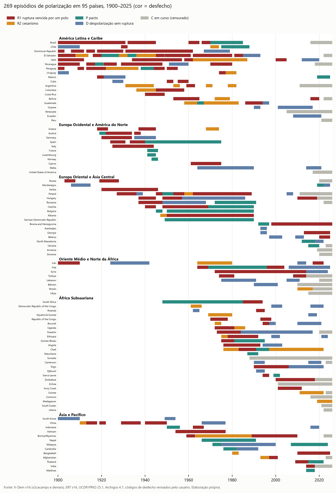
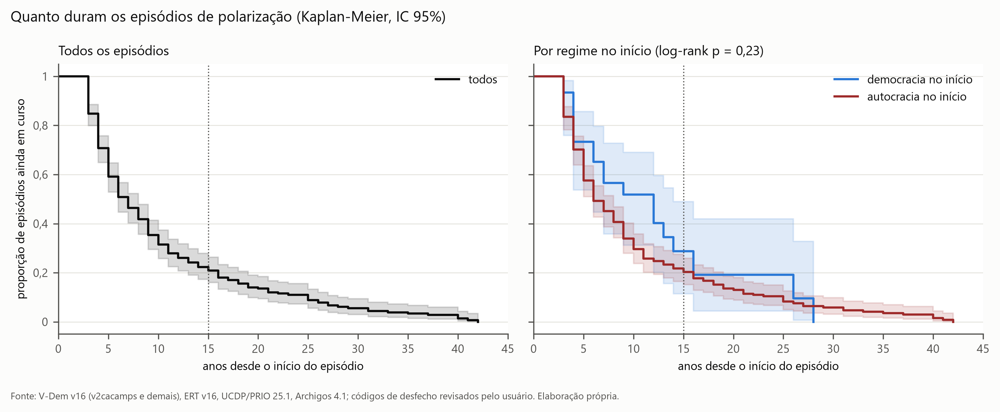
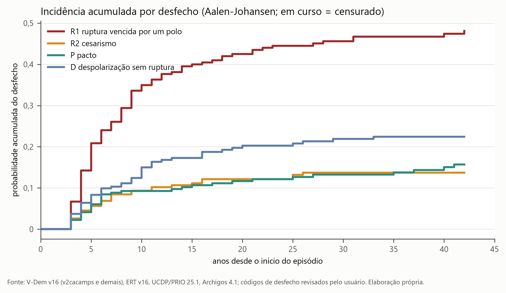
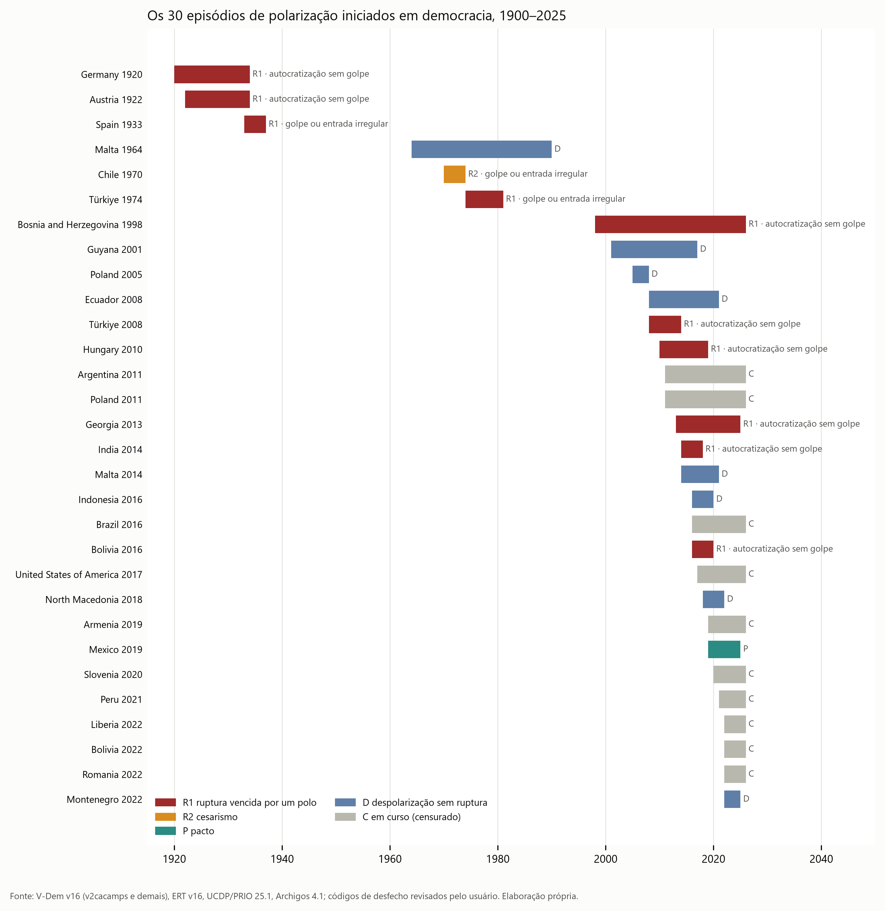
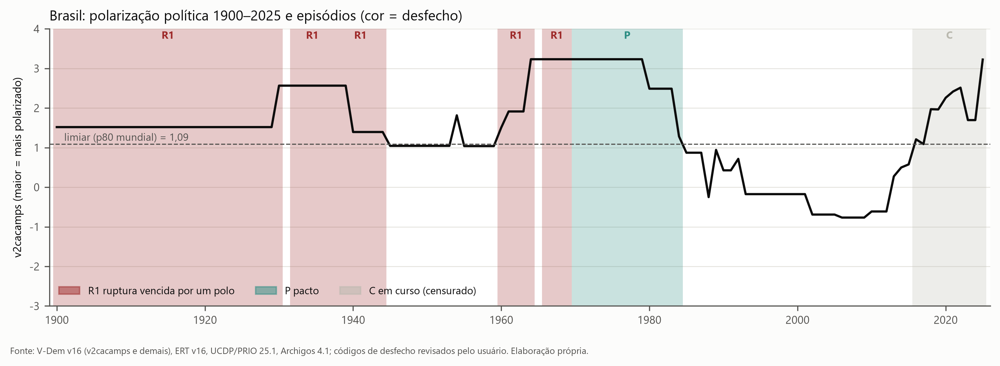
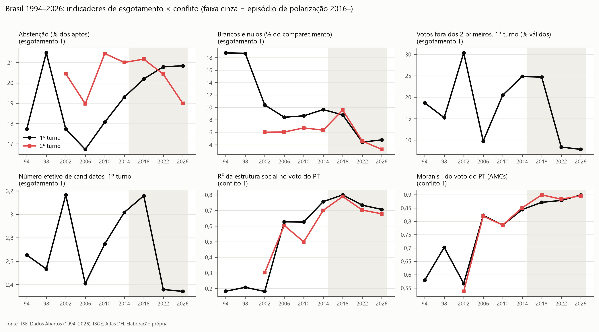

# A polarização se resolve? Episódios de polarização política no mundo, 1900–2025, e a posição do Brasil

*Relatório do `docs/planos/plano3.md`. Versão de 28/10/2026. Código em `src/p3_*.py`, tabelas em `outputs/tables/p3_*`, figuras em `outputs/figures/p3_*` (PNG 300 dpi e SVG). Decisões de dados, revisões manuais e pendências em `outputs/pendencias.md` e `data/manual/`.*

> **O que se mede.** A polarização é a variável `v2cacamps` do V-Dem: especialistas respondem se a sociedade está dividida em campos políticos antagônicos, a ponto de apoiadores de campos opostos evitarem a convivência social. Não é polarização afetiva medida em indivíduos. Os desfechos foram pré-codificados a partir das bases e revisados pelo usuário em 50 episódios.

---

## Resumo

**Pergunta.** Episódios de polarização intensa se resolvem necessariamente, por conflito ou por esgotamento, ou podem durar décadas como empate? Onde está o Brasil de 2016–2025?

**Resposta curta.** A polarização intensa quase sempre termina, e termina mais por ruptura do que por qualquer outra via. Mas não necessariamente: 38% dos episódios encerrados acabam em despolarização ou pacto, e um em cada cinco dura 15 anos ou mais. O "cesarismo" (Brumário) é minoritário. **Nas democracias, o desfecho típico de ruptura não é golpe, e sim a autocratização por dentro.** O Brasil está num episódio iniciado em democracia, com dez anos, intensidade entre as mais altas já registradas e indicadores eleitorais de conflito, não de esgotamento.

| Hipótese | Veredito | Evidência central |
|---|---|---|
| **H0** – a polarização termina por conflito (vitória de um polo) ou por esgotamento (cesarismo) | **Parcial** | 62% dos 237 episódios encerrados terminam em ruptura (49% vitória de um polo, 14% cesarismo); 38% em despolarização ou pacto. Frequente, não necessário. |
| **H1** – empate crônico (15 anos ou mais) | **Parcial** | 21% dos episódios seguem em curso após 15 anos (29% dos iniciados em democracia); após 30 anos, 5%. O empate longo existe, mas é minoria e acaba. |
| **H2** – pacto | **Parcial, fraca em democracia** | 15% dos encerrados, quase todos transições de autocracias (1989, fim de ditaduras). Entre os episódios democráticos, 1 em 20 (México 2019–2024). |
| **H3** – sequência: o cesarismo vem depois do conflito | **Parcial** | 61% dos cesarismos tiveram guerra civil ou tentativa de golpe antes, contra 37% das vitórias de um polo (Fisher p = 0,03). Não se sustenta com a medida ampla de violência nem pela ordem dos episódios no mesmo país. |
| **H4** – a instabilidade depende de instituições, militares e economia | **Parcial** | Golpe no país na década anterior aumenta o risco de ruptura (HR 1,6–1,8); peso militar e presidencialismo aumentam o de cesarismo (HR 1,6 e 2,0–3,3, com 21 a 33 eventos). O nível de democracia só reduz o risco entre os episódios iniciados em democracia (HR 0,36, p = 0,03). |

---

## 1. Dados e definição de episódio

| Item | Escolha |
|---|---|
| Polarização | V-Dem v16, `v2cacamps`, 1900–2025 (escala latente; maior = mais polarizado) |
| Universo | Estados independentes (`v2svindep`); colônias ficam de fora |
| Episódio | Anos seguidos com `v2cacamps` acima do percentil 80 mundial (1,09, parte alta da categoria "mais hostil que amistoso"); um ano isolado abaixo não interrompe; duração mínima de 3 anos |
| Fim do episódio | Dois anos seguidos abaixo do limiar, ou **ruptura** (golpe, entrada irregular do líder ou mudança de categoria de regime). Se a polarização segue alta sob o novo regime, começa outro episódio. |
| Rupturas e contexto | Golpes de Powell e Thyne via V-Dem (`e_pt_coup`; `e_coups` antes de 1950); guerra civil (`e_civil_war` e UCDP/PRIO 25.1); ERT v16; Archigos 4.1 |
| Desfechos | R1 vitória de um polo; R2 cesarismo; P pacto; D despolarização sem ruptura; C em curso |
| Exclusões | França 1934–1940 e Ucrânia 2020–2022: desfecho por invasão externa (decisão do usuário) |

Resultado: **269 episódios em 95 países**, 237 encerrados e 32 em curso em 2025. A definição captura 9 dos 12 casos de referência do plano. França 1789 está fora da cobertura. Rússia 1917 e Itália 1922 ficam de fora porque o V-Dem só registra polarização alta no próprio ano da ruptura.

*Figura 1. Episódios de polarização por país e desfecho, 1900–2025. Fonte: V-Dem v16, ERT v16, UCDP/PRIO 25.1, Archigos 4.1; códigos revisados pelo usuário.*

**A polarização medida é, sobretudo, um fenômeno de autocracias.** Só 30 dos 269 episódios começam em democracia, e 22 deles depois de 2005. A pergunta do plano, pensada a partir de democracias polarizadas, tem um N democrático pequeno e recente; por isso a seção 4 trata esse recorte em separado.

---

## 2. Quanto duram e como terminam (H0, H1, H2)

| Desfecho | Episódios | % dos encerrados | Duração mediana |
|---|---|---|---|
| R1 vitória de um polo | 115 | 49% | 6 anos |
| R2 cesarismo | 33 | 14% | 6 anos |
| P pacto | 36 | 15% | 6 anos |
| D despolarização sem ruptura | 53 | 22% | 7 anos |
| C em curso | 32 | — | 7 anos até agora |

*Figura 2. Proporção de episódios ainda em curso por tempo desde o início, geral e por regime no início, IC 95%. Fonte: V-Dem v16 e bases de rupturas; elaboração própria.*

- **Duração.** Mediana de 7 anos; 59% duram mais de 5 anos, 32% mais de 10, **21% mais de 15**, 5% mais de 30. Episódios iniciados em democracia duram mais (mediana de 12 anos), mas a diferença não é significativa (log-rank p = 0,23).
- **Riscos competitivos.** Em 15 anos, a probabilidade acumulada de cada desfecho é: vitória de um polo 40%, despolarização 17%, cesarismo 11%, pacto 11%; 21% seguem em curso.

*Figura 3. Incidência acumulada por desfecho (Aalen-Johansen em tempo discreto; episódios em curso censurados). Fonte: V-Dem v16 e bases de rupturas; elaboração própria.*

**Leitura.** H0 descreve bem o caso modal, mas não o universo: "termina" é quase certo; "termina por conflito ou cesarismo" vale para dois terços dos casos. **H1** tem lugar real: há episódios de 25 a 40 anos (Malta 1964–1989, Hungria 1957–1985, Polônia 1962–1988, Síria 1972–2013), mas são minoria e terminam. **H2** aparece em 15% dos casos encerrados, quase sempre como transição de autocracias (Europa Oriental em 1989, Brasil 1985, Chile 1987). Também entram como pacto as libertações do fim da Segunda Guerra na França, no Luxemburgo e na Noruega (ver limitações).

---

## 3. O que muda o risco de cada desfecho (H3, H4)

Cox por causa, covariáveis no início do episódio, EP agrupado por país. Razão de riscos (HR) por 1 DP (contínuas) ou para 0→1 (dummies); entre colchetes, o número de eventos.

| Covariável no início | Ruptura (R1+R2) [146] | Vitória de um polo [113] | Cesarismo [33] | Pacto [36] | Despolarização [52] |
|---|---|---|---|---|---|
| Golpe no país nos 10 anos anteriores | **1,58** | **1,59** | 1,50 | 1,42 | **0,35** |
| Dimensão militar do Executivo | **1,22** | 1,11 | **1,56** | 0,98 | 1,19 |
| Presidencialismo | **1,38** | 1,21 | **2,03** | 0,54 | 0,81 |
| Restrições judiciais ao Executivo | **1,23** | 1,23 | 1,18 | 1,38 | 0,95 |
| Democracia eleitoral (`v2x_polyarchy`) | 0,85 | 0,87 | 0,80 | 0,71 | 1,25 |

*Negrito: p < 0,05. No modelo ampliado (195 episódios, com crescimento do PIB e institucionalização partidária), o crescimento reduz a chance de despolarização e de pacto (HR 0,73 e 0,74) e o presidencialismo eleva o risco de cesarismo para 3,3 (21 eventos). Tabela completa em `p3_cox_causa`.*

- **H4.** A história importa mais que o nível institucional: um golpe recente aumenta a ruptura e quase elimina a despolarização. O peso militar e o presidencialismo empurram para o cesarismo. O nível de democracia não muda o risco no conjunto. Entre os episódios iniciados em democracia, quanto mais democrático, menor o risco de ruptura (HR 0,36, p = 0,03, 20 episódios encerrados). O sinal positivo de restrições judiciais é contraintuitivo e pequeno.
- **H3 (Brinton).** O cesarismo é mais precedido de conflito aberto: guerra civil ou tentativa de golpe fracassada em 61% dos casos, contra 37% nas vitórias de um polo, 32% nas despolarizações e 25% nos pactos (p = 0,03 entre R2 e R1). Com a medida ampla, que inclui violência política frequente, quase todos os desfechos têm conflito prévio e a diferença some. Também não há sequência entre episódios: uma vitória de um polo no mesmo país nos 15 anos anteriores é igualmente comum antes de todos os desfechos (33–39%).

**Robustez.** As conclusões se mantêm nas definições alternativas (limiar no p75 e p90, duração mínima de 2 e 5 anos), só no pós-1945 e sem guerras entre Estados: a ruptura fica entre 56% e 62% dos encerrados (45% na versão com `v2smpolsoc`, só 2000–2025), 16–30% seguem em curso após 15 anos (33% com `v2smpolsoc`), e a dimensão militar eleva o risco de ruptura em todas essas variantes (HR 1,2–1,6), mas não no recorte democrático (HR 0,67, n.s.). Tabela `p3_robustez`.

---

## 4. Recorte: episódios iniciados em democracia

*Figura 4. Os 30 episódios iniciados em democracia, com desfecho e tipo de ruptura. Fonte: V-Dem v16 e bases de rupturas; códigos revisados pelo usuário.*

| | Episódios |
|---|---|
| Iniciados em democracia | 30 (22 desde 2005) |
| Em curso em 2025 | 10: Brasil, EUA, Polônia, Argentina, Peru, Armênia, Eslovênia, Romênia, Libéria, Bolívia |
| Encerrados | 20: **vitória de um polo 10**, despolarização 8, cesarismo 1 (Chile 1973), pacto 1 (México 2019–2024) |

1. **A ruptura democrática é sobretudo autocratização por dentro.** Das 11 rupturas, 3 foram golpe (Espanha 1936, Chile 1973, Turquia 1980) e 8 foram autocratização sem golpe: Alemanha e Áustria 1933, Bósnia, Turquia 2013, Hungria 2018, Índia 2017, Bolívia 2019, Geórgia 2024. Não se atribui autoria pelo dado: o V-Dem registra o chefe de Estado, e em sistemas parlamentaristas quem governa é outro.
2. **A alternativa real é despolarizar, não pactuar.** Malta, Guiana, Equador, Polônia 2005–2007, Indonésia, Macedônia do Norte, Montenegro.
3. **O que separa ruptura de não ruptura é a intensidade, não as instituições.** O pico de polarização é maior onde houve ruptura (2,0 contra 1,56, excluindo o ano da ruptura; p = 0,006). Democracia, controles judiciais, militares, partidos e presidencialismo não diferem entre os grupos (11 contra 9 casos: só descritivo).
4. **As definições alternativas confirmam o quadro.** Com o percentil 75 ou duração mínima de 2 anos (39–41 episódios), a vitória de um polo fica em 48% e a despolarização entre 37% e 44%.

---

## 5. Brasil

*Figura 5. Polarização política no Brasil (v2cacamps), 1900–2025, com os episódios e seus desfechos. Fonte: V-Dem v16; códigos revisados pelo usuário.*

**Os episódios brasileiros.** 1900–1930 (vitória de um polo, 1930), 1932–1937 e 1938–1944 (vitória de um polo em 1937 e 1945), 1960–1964 (vitória de um polo: golpe de 1964), 1966–1969 (vitória de um polo, 1969), 1970–1984 (pacto: transição de 1985) e **2016–2025, em curso**.

**1960–1964 × 2016–2025** (covariáveis no início do episódio):

| | 1960 | 2016 |
|---|---|---|
| Regime | autocracia eleitoral (V-Dem) | democracia eleitoral |
| Democracia eleitoral (0–1) | 0,41 | 0,78 |
| Restrições judiciais (0–1) | 0,54 | 0,87 |
| Dimensão militar (0–1) | 0,44 | 0,22 |
| Institucionalização partidária (0–1) | 0,31 | 0,71 |
| Golpe na década anterior | sim | não |
| Crescimento do PIB per capita (3 anos) | +6,9% | −2,8% |
| Pico de polarização | 3,23 | 3,22 (2025) |

O episódio atual começou com instituições muito mais fortes que o de 1960 e sem golpe recente, mas com economia em recessão e a mesma intensidade de polarização no pico. A dimensão militar (0,22) é o dobro da média dos episódios democráticos (≈ 0,1).

**Exercício condicional, não previsão.** Para um episódio com o perfil do Brasil em 2016 que já dura 10 anos, os modelos de Cox por causa dão, nos próximos 10 anos:

| Desfecho | Probabilidade | IC 95% |
|---|---|---|
| Despolarização sem ruptura | 29% | 9–57% |
| Vitória de um polo | 24% | 12–50% |
| Cesarismo | 9% | 1–26% |
| Pacto | 3% | 0–10% |
| Ainda em curso | 36% | — |

Os intervalos são largos: o modelo combina 269 episódios de todos os regimes, e o perfil brasileiro (democracia presidencialista com instituições fortes) tem poucos pares. Dois pontos qualificam a média do modelo:
- **Intensidade.** O pico de 2016–2024 (2,51) já superava a média das democracias que terminaram em ruptura (2,0), e 2025 chegou a 3,22. Entre os episódios democráticos, só Espanha 1936 e Polônia 2011– tiveram picos maiores.
- **Presidencialismo, sinal ambíguo.** No conjunto dos episódios, o presidencialismo eleva o risco de cesarismo. Mas, entre os 20 episódios democráticos encerrados, os 5 presidencialistas terminaram de forma variada: Chile 1973 (cesarismo), Bolívia 2019 (vitória de um polo), Equador e Indonésia (despolarização), México (pacto).

**Esgotamento ou conflito? (Fase E, eleições presidenciais de 1994 a 2026; 1989 não está no repositório do TSE)**

*Figura 6. Indicadores de esgotamento (abstenção, brancos e nulos, votos fora dos dois primeiros, número efetivo de candidatos) e de conflito (R² da estrutura social, Moran's I) do voto presidencial, 1994–2026. Fonte: TSE, Dados Abertos; IBGE; Atlas DH.*

| | 2006 | 2014 | 2018 | 2022 | 2026 |
|---|---|---|---|---|---|
| Abstenção, 1º turno | 16,7% | 19,3% | 20,2% | 20,8% | 20,8% |
| Brancos e nulos, 1º turno | 8,4% | 9,7% | 8,8% | 4,4% | 4,8% |
| Fora dos 2 primeiros, 1º turno | 9,8% | 24,8% | 24,7% | 8,4% | 7,8% |
| Número efetivo de candidatos | 2,41 | 3,02 | 3,16 | 2,36 | 2,34 |
| R² da estrutura social (voto PT, 1º turno) | 0,63 | 0,76 | 0,80 | 0,73 | 0,71 |
| Moran's I (voto PT, 1º turno) | 0,82 | 0,84 | 0,87 | 0,88 | 0,90 |

Desde 2022, o voto presidencial está **bipolarizado e geograficamente concentrado como nunca na série**: o menor número efetivo de candidatos, a menor fatia de terceiros e o maior Moran's I desde 1994. Esses são sinais de conflito, não de esgotamento. O único indicador de esgotamento, a abstenção do 1º turno, subiu até 2022 e estabilizou, e no 2º turno de 2026 caiu para 19,0%. Há um sinal de afrouxamento: o R² da estrutura social atingiu o pico em 2018 e recua desde então. O voto continua muito estruturado, mas um pouco menos preso à geografia social.

**Síntese para o Brasil.** Pela comparação internacional, o episódio atual está na faixa em que os casos democráticos se dividem entre despolarização e autocratização por dentro, com intensidade do lado dos que romperam e instituições do lado dos que despolarizaram. O cesarismo e o pacto, os dois desfechos que a analogia histórica (Brumário; Colômbia 1958, Espanha 1977) costuma evocar, são raros entre democracias. Os indicadores eleitorais não mostram esgotamento.

---

## 6. Limitações

1. **Viés retrospectivo do V-Dem.** Especialistas codificam sabendo o desfecho. Rússia 1917 e Itália 1922 só aparecem polarizadas no ano da ruptura, e em 4 das 11 rupturas democráticas o pico cai no último ano. O pico sem o último ano ainda separa ruptura de não ruptura, mas a relação entre intensidade e ruptura deve ser lida com isso em mente.
2. **N pequeno.** 33 cesarismos, 36 pactos e só 20 episódios democráticos encerrados. As tabelas trazem o número de eventos ao lado de cada estimativa.
3. **Polarização afetiva ≠ `v2cacamps`.** A variável mede campos antagônicos na sociedade segundo especialistas, não afeto individual. Para o Brasil recente, o passo seguinte é cruzar com o ESEB.
4. **A codificação de R1 × R2 e de pactos depende de julgamento.** O usuário revisou 50 episódios. Nos demais vale o pré-código das bases. O pacto inclui transições de colapso (1989) e as libertações do fim da Segunda Guerra (França 1941–1945, Luxemburgo 1941–1944, Noruega 1943–1945). **Por decisão do usuário, as libertações ficam na análise**: foram promovidas também por agentes internos (como a Resistência francesa), que atuaram junto com os Aliados. É também o caso da Iugoslávia e da Grécia com os partisans (episódios SRB-1942 e GRC-1937, codificados como vitória de um polo). Só França 1940 e Ucrânia 2022, desfechos de invasão, foram excluídos.
5. **Fontes substituídas.** Powell e Thyne e Correlates of War não puderam ser baixados desta rede. Os dados vieram das mesmas fontes embutidas no V-Dem, só por país-ano. O PIB do V-Dem termina em 2019, e o Archigos, em 2015.
6. **Métodos.** A `lifelines` não tem Fine-Gray. As probabilidades do Brasil combinam os Cox por causa, e a incidência acumulada usa Aalen-Johansen em tempo discreto (durações em anos inteiros).
7. **Fase E.** Sem 1989. A queda de brancos e nulos entre 1998 e 2002 coincide com a urna eletrônica em todo o país. O R² usa a estrutura social de 2010 para todos os anos.
8. **A análise do Brasil é condicional ao modelo; não é previsão eleitoral nem de regime.**

---

## Referências

Conforme o `docs/planos/plano3.md`. Edições e páginas devem ser conferidas antes de publicação.

- Brinton, C. (1938). *The Anatomy of Revolution*.
- Gramsci, A. *Cadernos do cárcere* (cesarismo).
- Linz, J. (1978). *The Breakdown of Democratic Regimes*.
- Marx, K. (1852). *O 18 de Brumário de Luís Bonaparte*.
- McCoy, J.; Rahman, T.; Somer, M. (2018). *American Behavioral Scientist*.
- McCoy, J.; Somer, M. (2019). *The ANNALS of the American Academy of Political and Social Science*.
- Portantiero, J. C. (1977). Empate hegemónico.
- Santos, W. G. dos (1986). *Sessenta e quatro: anatomia da crise*.
- Sartori, G. (1976). *Parties and Party Systems*.
- Stepan, A. (1971). *The Military in Politics*.

**Dados:**
- V-Dem v16 (Coppedge et al., 2026), via `vdeminstitute/vdemdata`; ERT v16, via `vdeminstitute/ERT`.
- UCDP/PRIO Armed Conflict Dataset v25.1.
- Archigos 4.1 (Goemans, Gleditsch e Chiozza).
- TSE, Dados Abertos (Portal Resultados para o crosswalk de municípios).
