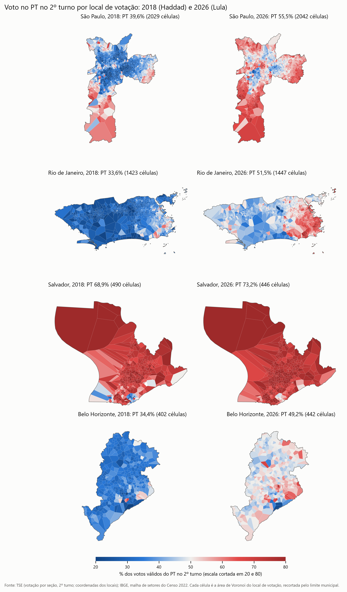
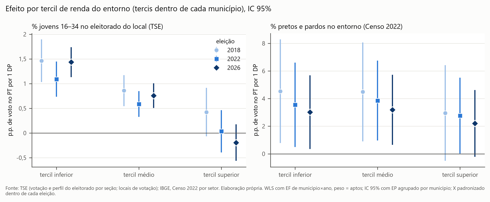
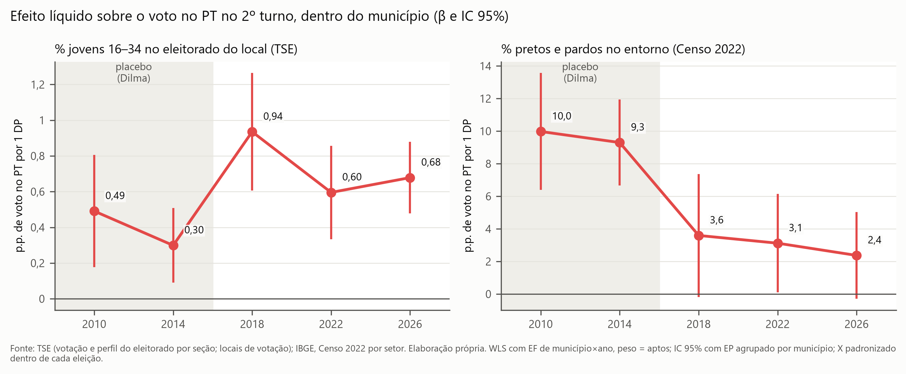
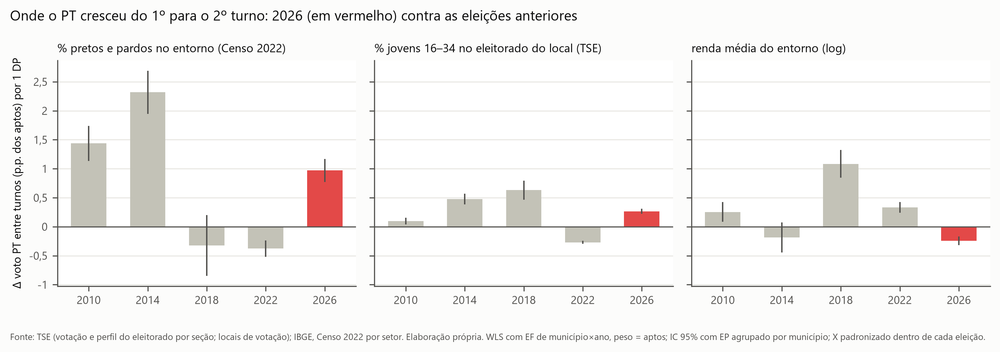

# Existe um "pacto lulista 2.0"? Evidência intraurbana por local de votação (2010–2026)

*Relatório da Fase E do `plano2.md`. Versão de 28/10/2026. Código em `src/pacto20_*.py`, tabelas em `outputs/tables/pacto20_*`, figuras em `outputs/figures/pacto20_*` (PNG 300 dpi e SVG). Decisões de dados e pendências em `outputs/pendencias.md`.*

> **Leitura ecológica.** A unidade é o **local de votação**, não o eleitor. "Locais com mais jovens votam mais no PT" não implica que "jovens votam mais no PT". O eleitor vota onde está o título, que nem sempre é onde mora. A composição racial e a renda vêm do **entorno censitário do local** (Censo 2022), não do eleitorado.

---

## Resumo

**Pergunta.** Entre 2018, 2022 e 2026, dentro das mesmas cidades, os locais de votação com mais eleitores jovens e mais população negra passaram a votar mais no PT, líquido de renda? Esse alinhamento é durável e tem assinatura de mobilização entre o 1º e o 2º turno de 2026?

**Resposta curta: não há "pacto 2.0".** O que 2026 mostra é uma **mobilização conjuntural** no 2º turno, concentrada em áreas mais pobres e mais negras das cidades, sobre uma base racial que é **antiga e vem enfraquecendo** desde Dilma. O único componente novo, o geracional, apareceu em 2018 e não cresceu desde então.

| Critério | Veredito | Evidência central |
|---|---|---|
| 1. Associação líquida de renda | **Parcial** | Jovens (+0,8 p.p./DP) e negros (+3,4) puxam o voto no PT em 2026 nos tercis inferior e médio de renda; no superior, jovens somem (−0,2, n.s.) e negros enfraquecem (+2,2, p = 0,07). |
| 2. Tendência (durabilidade) | **Não sustentado** | Jovens: 0,94 → 0,60 → 0,68 (Δ 2026−2018 = −0,26, p = 0,003). Negros: 3,6 → 3,1 → 2,4 (Δ 2026−2022 = −0,75, p = 0,001). O placebo mostra negros em 10,0 (2010) e 9,3 (2014). |
| 3. Voto proporcional | **Não testado** | Fora do escopo por decisão do usuário (ver §5). |
| 4. Mobilização entre turnos de 2026 | **Sustentado** | 2026 é a única das cinco eleições com alta clara do comparecimento entre turnos (+1,9 p.p.). O PT cresceu mais em locais negros (+1,0 p.p. dos aptos/DP) e mais pobres (−0,24 por DP de renda); este último sinal é inédito na série. |
| 5. Heterogeneidade | **Forte** | Padrão do Centro-Sul: negros +11,7 no Sul e +5,9 no Sudeste; −6,0 no Norte; jovens negativos no Nordeste (−0,24). Nas capitais o efeito de negros não é significativo. |

**Veredito geral.** Pela regra do `plano2.md`, "pacto 2.0" exige os critérios 1, 2 e 3; com 1 parcial, 2 não sustentado e 3 não testado, não se sustenta. A combinação observada, critério 1 parcial e critério 4 sustentado, é a que o plano classifica como **mobilização conjuntural antibolsonarista**.

---

## 1. Dados e desenho

| Item | Escolha |
|---|---|
| Unidade | Local de votação (seções agregadas por município × zona × número original do local) |
| Eleições | 2º turno presidencial de 2018, 2022 e 2026; 2010 e 2014 como placebo |
| Escopo | Municípios com ≥ 10 locais: cerca de 2.500 municípios, 77–79 mil locais, 87% do eleitorado |
| Jovens | % do eleitorado do local com 16–34 anos (TSE, perfil por seção) |
| Negros, renda, densidade | Entorno do local por células de Voronoi recortadas pelo limite municipal, agregando setores do Censo 2022 (população × fração de área); buffer de 800 m como alternativa |
| Modelo | WLS com efeito fixo de município (ou município × ano), peso = aptos, EP agrupado por município, X padronizado dentro de cada eleição |
| Coordenadas | Do TSE; locais sem coordenada herdam a do mesmo local em outro ano (sem geocodificação externa); 98,4% (2018) a 99,6% (2026) do eleitorado com entorno |

Os coeficientes estão em **pontos percentuais de voto no PT (2º turno, % dos válidos) por 1 desvio-padrão** da variável. Para converter: 1 DP de jovens ≈ 10,7 p.p. do eleitorado do local; 1 DP de negros ≈ 24,6 p.p. do entorno (2026).

*Figura 1. s_PT no 2º turno por local de votação (células de Voronoi), 2018 e 2026. Fonte: TSE, votação por seção e coordenadas dos locais; IBGE, malha de setores do Censo 2022.*

---

## 2. Critério 1: associação líquida de renda

Em 2026, dentro do município, locais com mais jovens e entornos mais negros votam mais no PT, mesmo controlando renda e densidade: jovens +0,79 (EP 0,13) e negros +3,41 (EP 1,21). As interações com renda são **negativas**: o efeito dos dois encolhe nos bairros mais ricos (jovens × renda −0,37, p = 0,05; negros × renda −0,84, p < 0,001).

*Figura 2. Efeito de jovens e negros por tercil de renda do entorno (tercis dentro de cada município), 2018, 2022 e 2026, IC 95%. Fonte: TSE; IBGE, Censo 2022 por setor.*

| 2026 | Tercil inferior | Médio | Superior | Superior − inferior |
|---|---|---|---|---|
| Jovens | +1,44*** | +0,76*** | −0,19 | −1,63*** |
| Negros | +3,02* | +3,19* | +2,20 (p = 0,07) | −0,82** |

O plano exige efeito positivo **também no tercil médio e no superior**. Vale no médio e não vale no superior, especialmente para jovens. Isso vale nas três eleições, e o gradiente piora em 2026: jovens ricos não votam no PT. **Veredito: parcial.**

---

## 3. Critério 2: tendência e placebo

Modelo empilhado com efeito fixo de município × ano.

*Figura 3. β de jovens e negros por eleição, 2010–2026 (2010 e 2014 = placebo), IC 95%. Fonte: TSE; IBGE, Censo 2022 por setor.*

| β | 2010 | 2014 | 2018 | 2022 | 2026 |
|---|---|---|---|---|---|
| Jovens | 0,49 | 0,30 | **0,94** | 0,60 | 0,68 |
| Negros | **10,0** | 9,3 | 3,6 | 3,1 | 2,4 |

- **Negros: o pacto antigo se diluindo, não um novo.** O alinhamento racial intraurbano era quatro vezes mais forte com Dilma. Caiu de 2014 para 2018 e segue caindo (Δ 2026−2014 = −6,9; Δ 2026−2022 = −0,75; ambos p ≤ 0,001).
- **Jovens: o único componente novo.** O efeito triplica de 2014 para 2018 (Haddad × Bolsonaro) e em 2026 continua acima do patamar de Dilma (Δ 2026−2014 = +0,38, p < 0,001). Mas recua de 2018 para 2022 e fica estável em 2026 (Δ 2026−2018 = −0,26, p = 0,003). É um realinhamento geracional de 2018, não uma tendência crescente.
- O resultado se repete no painel de locais presentes nas três eleições (208 mil locais-ano).

**Veredito: não sustentado.** Não há fortalecimento do alinhamento entre 2018 e 2026.

---

## 4. Critério 4: mobilização entre o 1º e o 2º turno

### 4.1 2026 contra as eleições anteriores

| Variação entre turnos (p.p. dos aptos) | 2010 | 2014 | 2018 | 2022 | 2026 |
|---|---|---|---|---|---|
| Comparecimento | −3,4 | −1,7 | −0,9 | +0,4 | **+1,9** |
| Voto PT | +6,4 | +8,4 | +11,1 | +2,1 | +6,7 |
| Voto opositor | +8,3 | +12,0 | +5,9 | +4,7 | **+2,4** |

A média da amostra (+1,9 p.p.) bate com a queda da abstenção nacional sem exterior, de 20,84% para 18,99%.

*Figura 4. Δ voto PT entre turnos (p.p. dos aptos) por 1 DP de negros, jovens e renda, cinco eleições; 2026 em vermelho. Fonte: TSE; IBGE, Censo 2022 por setor.*

- **Renda: o traço inédito de 2026.** É a única eleição em que o PT cresceu mais entre turnos nos locais mais pobres da cidade (−0,24 por DP de renda), enquanto o opositor cresceu mais nos mais ricos (+0,24). Nas outras quatro eleições o sinal de renda era positivo ou nulo.
- **Áreas negras.** Comparecimento +0,25 e voto PT +0,97 por DP. A diferença para 2018 e 2022 (quando o ganho do PT ali era negativo) é significativa. Mas 2010 (+1,4) e 2014 (+2,3) tiveram ganhos iguais ou maiores: é uma volta ao padrão de Dilma.
- **Jovens.** O comparecimento cresce menos em locais jovens em todas as eleições; em 2026 a desvantagem é a menor (−0,14). O ganho do PT ali (+0,27) fica no meio da série.

### 4.2 De onde vieram os votos de Lula no 2º turno (regressão ecológica, quatro capitais)

Regressão ecológica restrita (Goodman): matriz de transferência única por cidade, proporções entre 0 e 1 que somam 1 por origem, IC por bootstrap dos locais. A tabela mostra a % de cada origem do 1º turno que foi para Lula no 2º.

| Origem no 1º turno → Lula no 2º | São Paulo | Rio de Janeiro | Salvador | Belo Horizonte |
|---|---|---|---|---|
| Abstenção | 10 [10–11] | 11 [10–12] | 31 [28–34] | 10 [9–11] |
| Branco/nulo | 83 [82–85] | 72 [69–75] | 61 [56–65] | 76 [71–80] |
| Cury | 56 [50–62] | 70 [57–79] | 50 [27–74] | 65 [52–76] |
| Renan Santos | 29 [22–34] | 26 [16–36] | 0 [0–0] | 32 [21–44] |
| Caiado | 0 [0–0] | 17 [4–29] | 0 [0–0] | 0 [0–0] |

Os votos de Lula no 2º turno vieram de brancos e nulos do 1º turno, de eleitores de Cury e, em Salvador, de abstencionistas do 1º turno. Os eleitores de Caiado foram quase todos para Flávio, e os de Renan Santos majoritariamente. A inferência ecológica R×C pelo PyEI, prevista no plano, não terminou em São Paulo após mais de 3 horas de amostragem; ver §6.

### 4.3 Comparecimento por idade e sexo (dado direto do TSE)

- **Idade (por zona eleitoral).** Em 2018 e 2022, jovens compareceram menos no 2º turno que no 1º e idosos mais (2022: −0,9 p.p. entre 16–24 anos e +2,3 entre 60 ou mais). O arquivo de 2026 publicado pelo TSE só tem o 1º turno.
- **Sexo.** No 1º turno de 2026 as mulheres compareceram mais (80,1% contra 78,1%), mesma diferença de 2022. A variação entre turnos de 2026 por sexo depende do arquivo com o 2º turno. A estimativa ecológica por local foi **reprovada na validação**: errou o sinal em 2018 e 2022. Fica só o indício de que a mobilização de 2026 pode ter sido mais feminina (`pacto20_extra_sexo_*`).

**Veredito: sustentado.** Há assinatura de mobilização no 2º turno de 2026: alta do comparecimento, ganho do PT em áreas pobres e negras, transferência de brancos, nulos e votos de Cury.

---

## 5. Critério 3: voto proporcional (não testado)

Por decisão do usuário, a análise usa só a votação presidencial. A abstenção caiu bastante do 1º para o 2º turno de 2026, e muitos eleitores de Lula no 2º turno não votaram no 1º. Esses eleitores também não votaram para deputado. Para uma tese centrada em quem decidiu o 2º turno, o voto proporcional do 1º turno diz pouco. Sem o Critério 3 não é possível distinguir **alinhamento ideológico** (jovens e negros puxando também o bloco de esquerda) de **lulismo personalista**. A análise municipal do relatório principal (H5) sugere o segundo: o Bolsa Família estrutura o voto em Lula, mas não o voto no PT para deputado.

---

## 6. Critério 5 e robustez

**Heterogeneidade (2026).** O padrão é do Centro-Sul. \*\*\* p < 0,001; \*\* p < 0,01; \* p < 0,05.

| | Jovens | Negros |
|---|---|---|
| Capitais (27) | +1,01** | +3,9 (n.s., EP 5,0) |
| RM, exceto capital | +0,61*** | +5,5*** |
| Interior | +0,44*** | +0,8 (n.s.) |
| Sul | +1,37*** | +11,7*** |
| Sudeste | +0,89*** | +5,9** |
| Nordeste | **−0,24\*\*** | +2,1*** |
| Norte | +0,46*** | **−6,0\*\*\*** |
| Centro-Oeste | +0,79** | −2,9 (n.s.) |

**Robustez (Fase D).** A queda de 2018 para 2026 aparece em todas as variantes: entorno por buffer de 800 m, sem ponderação, só capitais, excluindo locais com menos de 300 aptos.
- Sem ponderação, o efeito de negros em 2026 quase some (0,19): ele vem das cidades grandes.
- Erros de Conley (2 e 5 km) são 3 a 4 vezes menores que os agrupados por município. O EP agrupado, usado em todo o relatório, é a escolha conservadora.
- Moran's I dos resíduos dentro dos municípios ≈ 0,31 (p < 0,001): há padrão de bairro que jovens, negros, renda e densidade não captam.

---

## 7. Limitações

1. **Leitura ecológica.** Locais, não eleitores. O eleitor vota onde está o título, não necessariamente onde mora.
2. **Entorno censitário é aproximação, e é de 2022 para todos os anos.** Em 2010 e 2014 há 8 a 12 anos de mudança nos bairros. A queda do efeito de negros desde Dilma é grande demais para ser só isso, mas o nível de 2010 deve ser lido com cautela.
3. **Cor/raça só via Censo.** O TSE não tem cor/raça utilizável (ausente em 2018; ~71% não informado em 2026).
4. **Idade do TSE ≠ idade do Censo**; alistamento facultativo aos 16–17 anos.
5. **Geração e idade não se separam** com dados agregados. Próximo passo: modelo idade-período-coorte com o ESEB 2002–2026.
6. **Inferência ecológica.** A regressão de Goodman supõe transferências constantes entre locais da cidade. O PyEI (R×C), previsto no plano, não convergiu em tempo útil em São Paulo (2.046 locais).
7. **Dados de 2026 incompletos no TSE.** Comparecimento por idade e sexo só no 1º turno (arquivo gerado em 13/10/2026).
8. **Critério 3 não testado** (decisão de escopo).

---

## Arquivos

- **Tabelas:**
  - Fase A: `pacto20_faseA_*` (base e matching)
  - Fase B: `pacto20_faseB_*` (entorno)
  - Fase C: `pacto20_faseC_*` (modelos)
  - Fase D: `pacto20_faseD_*` (robustez e placebo)
  - Extra: `pacto20_extra_sexo_*` (comparecimento por sexo)
- **Figuras:** `pacto20_mapas_capitais`, `pacto20_betas`, `pacto20_tercis`, `pacto20_mobilizacao`.
- **Código:** `src/pacto20_base.py`, `src/pacto20_entorno.py`, `src/pacto20_modelos.py`, `src/pacto20_robustez.py`, `src/pacto20_sexo.py`, `src/pacto20_saidas.py`.
