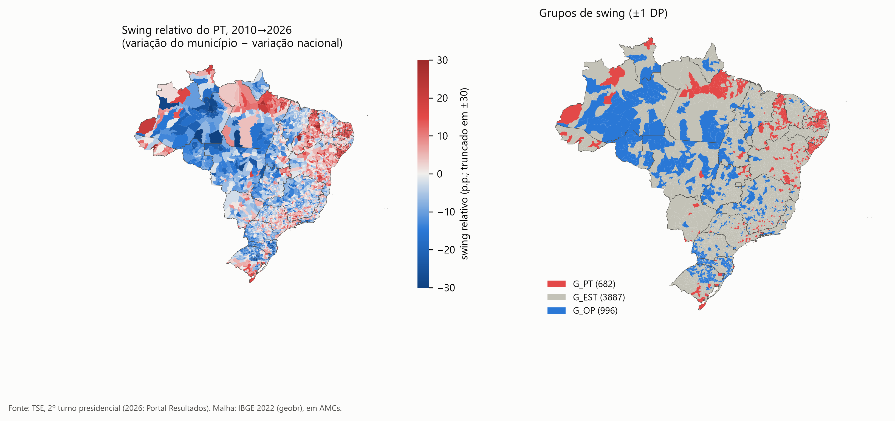
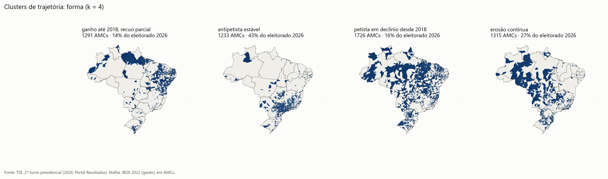
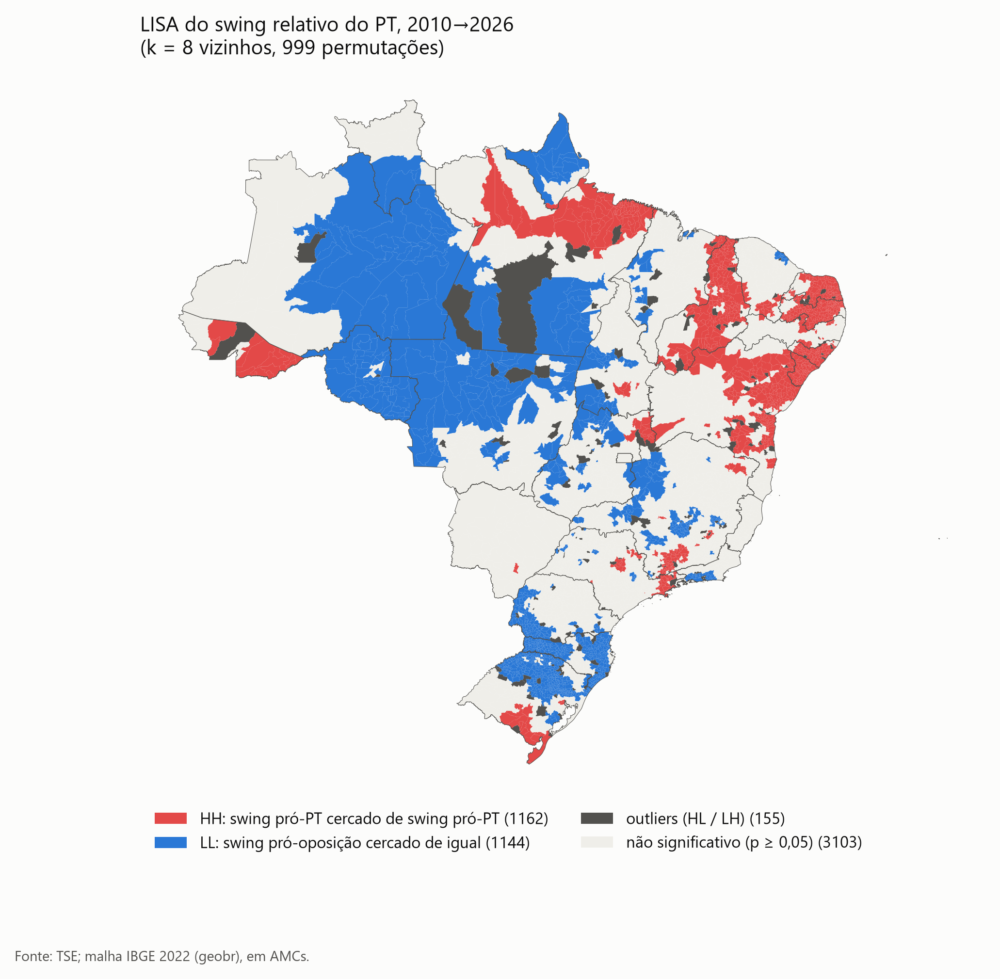
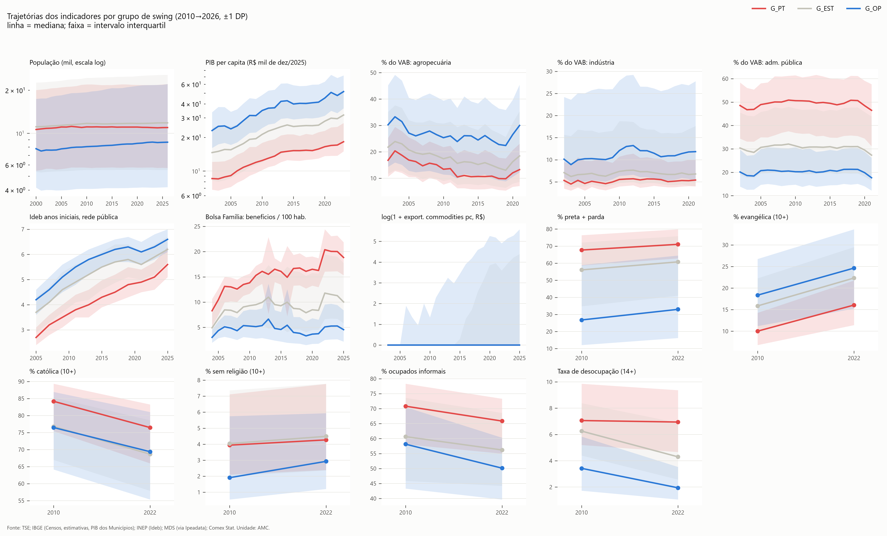
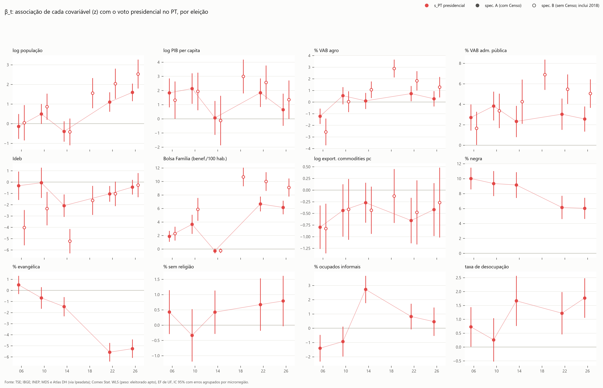
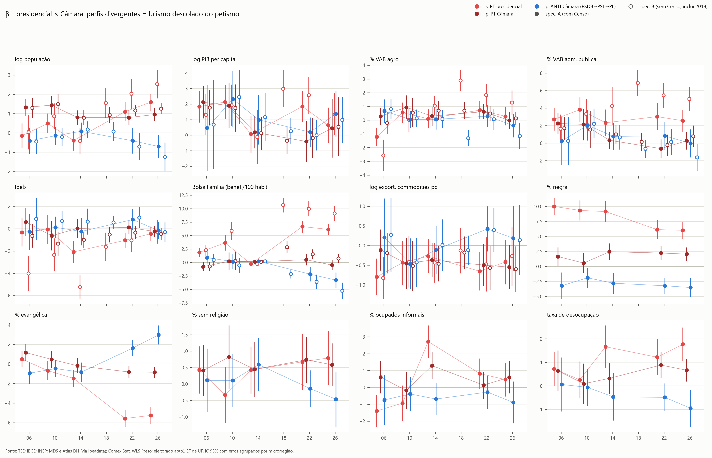
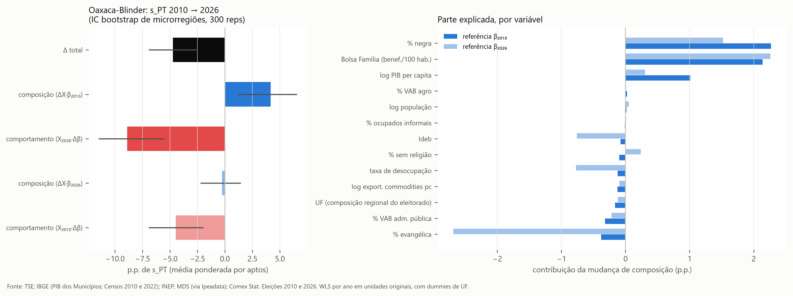
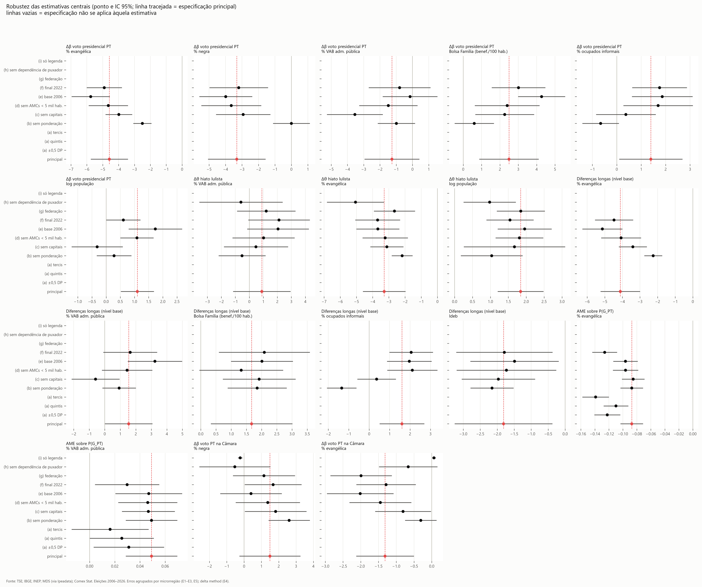

# O "pacto lulista" mudou de perfil? (2006–2026)

*Relatório consolidado da Fase 8. Versão de 27/10/2026, com todas as fontes incorporadas até esta data. Pipeline em `src/`, tabelas em `outputs/tables/` e figuras em `outputs/figures/` (PNG 300 dpi e SVG). Decisões de dados e pendências em `outputs/pendencias.md`. Este relatório substitui as notas parciais `fase5_achados.md`, `fase6_achados.md`, `fase7_achados.md` e `atualizacao_pbf_comex_idhm.md`.*

> **Leitura ecológica.** Todos os resultados descrevem **municípios, não eleitores**. "Municípios com mais evangélicos se deslocaram contra o PT" não implica que "evangélicos votaram contra o PT".

---

## Resumo executivo

**Pergunta.** A base territorial do voto petista no 2º turno presidencial, o realinhamento lulista de André Singer (municípios pobres, nordestinos, dependentes de transferências), se manteve, se deslocou ou se dissolveu entre 2010 e 2026?

**Resposta curta: o pacto persistiu no seu núcleo de pobreza, mas mudou de perfil em duas dimensões, e o "pacto mudou" pesa mais que o "Brasil mudou".**

1. **O núcleo de pobreza persiste e, nos municípios com mais eleitores, se reforça.**
   - O Bolsa Família por habitante é o marcador mais forte do voto petista: β de 3,7 p.p. por DP em 2010 e de 6,2 em 2026, com Δ = +2,5 (p = 0,003).
   - O sinal é positivo em todas as especificações. O **reforço** (Δ > 0), porém, some quando os municípios não são ponderados pelo eleitorado.
   - **Leitura conservadora: H1 é de persistência; o reforço vale para onde mora a maior parte do eleitorado.**
2. **A mudança mais nítida é religiosa (H2).**
   - O coeficiente de % evangélica foi de ≈ 0 (2006–2010) a −5,3 p.p. por DP (2026). Δ = −4,6 (p < 0,001) desde 2010 e −5,8 desde 2006. A virada ocorre entre 2014 e 2022.
   - É a única mudança robusta a **tudo** o que foi testado: peso, amostra, anos, limiares, erros-padrão espaciais, SEM e SAR.
3. **A raça perde peso líquido.** O β de % preta + parda cai de 9,3 para 6,0 (Δ = −3,3, p < 0,001). Parte da associação racial passava pela pobreza. A queda some sem ponderação.
4. **"O pacto mudou ou o Brasil mudou?"**
   - O voto médio no PT caiu 4,7 p.p. entre 2010 e 2026.
   - Pela decomposição de Oaxaca-Blinder, a mudança de **comportamento** (mesmo perfil votando diferente) explica −8,9 p.p. (β de 2010) ou −4,5 p.p. (β de 2026).
   - A mudança de **composição** é favorável ou neutra para o PT (+4,2 ou −0,3): a expansão do Bolsa Família e o aumento declarado de pretos e pardos compensam o crescimento evangélico.
5. **Lulismo ≠ petismo (H5).**
   - O Bolsa Família estrutura o voto em Lula, mas não o voto no PT para deputado (β ≈ 0 em todos os anos). O hiato presidencial − Câmara cresceu onde há mais Bolsa Família.
   - A base proporcional do PT encolheu (de 24% para 8% do eleitorado nas AMCs em que o PT lidera a Câmara) e passou de urbana e mais rica a pequena, pobre e negra.
6. **O antipetismo trocou de partido e de base (H6).**
   - O PL de 2022–2026 tem um voto para a Câmara muito mais estruturado socialmente que o PSDB (R² 0,63 contra 0,28–0,39).
   - O voto do PL é mais branco, mais evangélico e menos beneficiário do Bolsa Família. O β do Bolsa Família no voto do partido antipetista foi de +0,9 (PSDB 2006) a −3,3 (PL 2026).
7. **H3 (commodities) não se sustenta** com dados municipais: o Comex mede domicílio fiscal, e a maioria dos municípios não exporta. **H4 (recomposição urbana)** só vale para as capitais.

---

## 1. Dados e desenho

| Item | Escolha |
|---|---|
| Unidade | AMC 2010–2026: 5.565 unidades (6 municípios instalados depois de 2010 fundidos ao de origem) |
| Voto presidencial | 2º turno 2006–2026, TSE (CDN Dados Abertos; 2026 pelo Portal Resultados), sem exterior e trânsito |
| Voto proporcional | Deputado federal, nominal + legenda, PT e partido antipetista do ano (PSDB → PSL → PL) |
| Covariáveis anuais | População (IBGE), PIB e VAB (IBGE, PIB dos Municípios), Ideb (INEP), Bolsa Família (MDS via Ipeadata), exportações (Comex Stat), em R$ de dez/2025 (IPCA) |
| Covariáveis censitárias | Raça, religião, desocupação e informalidade (Censos 2010 e 2022, amostra); IDHM 2010 (Atlas DH) |
| Alinhamento | Covariáveis anuais com defasagem de 1 ano; Censo 2010 para 2006–2014 e Censo 2022 para 2022–2026; **2018 sem Censo** (o PLANO proíbe interpolar em regressão) |
| Modelo central | WLS ponderado pelo eleitorado apto, EF de UF, X em z-score dentro de cada eleição (β = p.p. por 1 DP), erros agrupados por microrregião (558) |

**Swing relativo** = (s_PT,m,2026 − s_PT,m,2010) − (s_PT,BR,2026 − s_PT,BR,2010). G_PT = swing ≥ +1 DP; G_OP = swing ≤ −1 DP; G_EST = faixa central.

**Contexto nacional** (% dos votos válidos, sem exterior):

| | 2006 | 2010 | 2014 | 2018 | 2022 | 2026 |
|---|---|---|---|---|---|---|
| PT, 2º turno presidencial | 60,8 | 56,1 | 51,7 | 44,9 | 50,9 | 51,8 |
| PT, Câmara (p_PT) | 14,9 | 16,9 | 13,9 | 10,3 | 12,1 | 13,0 |
| Antipetista, Câmara (p_ANTI) | 13,7 PSDB | 11,7 PSDB | 11,4 PSDB | 11,6 PSL | 16,6 PL | 22,7 PL |

---

## 2. Onde o PT ganhou e perdeu terreno relativo



*Figura 1. Swing relativo do PT de 2010 a 2026 e grupos G_PT / G_EST / G_OP (±1 DP). Fonte: TSE, 2º turno presidencial de 2010 e 2026 (2026: Portal Resultados); malha IBGE 2022 (geobr), em AMCs.*

| Grupo | AMCs | % do eleitorado |
|---|---|---|
| G_PT | 682 | 15,9 |
| G_EST | 3.887 | 69,6 |
| G_OP | 996 | 14,5 |

- **G_PT:** 29% das AMCs do Nordeste e 14% das do Norte. Concentra-se no litoral e no sertão nordestinos, no norte do Pará e no Amapá.
- **G_OP:** 45% das AMCs do Sul, 24% do Norte e 21% do Centro-Oeste. Ocupa o arco amazônico e agropecuário (RO, MT, AM, TO), o oeste catarinense e gaúcho e Roraima.
- As três operacionalizações do PLANO concordam no essencial: grupos de swing × clusters de trajetória, Cramér's V = 0,66.
  - 645 das 682 AMCs G_PT estão no cluster "ganho até 2018, recuo parcial".
  - 879 das 996 AMCs G_OP estão no cluster "erosão contínua".



*Figura 2. Clusters k-means (k = 4) das trajetórias de s_PT relativo ao nacional, 2010–2026. Fonte: TSE, 2º turno presidencial de 2010, 2014, 2018, 2022 e 2026; malha IBGE 2022.*

| Cluster | AMCs | % eleitorado | Centroide (p.p. vs. Brasil) 2010 → 2018 → 2026 |
|---|---|---|---|
| 1. Ganho até 2018, recuo parcial | 1.291 | 14,4 | +8,0 → +29,5 → +20,2 |
| 2. Antipetista estável | 1.233 | 43,0 | −7,4 → −8,3 → −6,9 |
| 3. Petista em declínio desde 2018 | 1.726 | 15,8 | +10,0 → +17,9 → +6,9 |
| 4. Erosão contínua | 1.315 | 26,8 | +0,5 → −8,3 → −14,0 |

**2018 é o ponto de inflexão.** O cluster 1 atingiu o pico relativo quando Haddad perdeu, e os clusters 3 e 4 começaram a cair ali.



*Figura 3. LISA do swing relativo 2010→2026 (8 vizinhos mais próximos, 999 permutações, p < 0,05). Fonte: TSE, 2º turno presidencial de 2010 e 2026; malha IBGE 2022.*

- O swing é fortemente concentrado no espaço (Moran's I = 0,67), e o próprio voto presidencial no PT ficou mais concentrado: I de 0,81 em 2006 para 0,90 em 2026.
- **LISA:** 1.162 AMCs no cluster HH (pró-PT), 1.144 no LL (pró-oposição), 155 outliers e 3.103 não significativas.

---

## 3. Quem se moveu: perfis e trajetórias



*Figura 4. Mediana e intervalo interquartil dos indicadores por grupo de swing. Fonte: TSE; IBGE (estimativas e Censos 2000, 2010 e 2022; PIB dos Municípios 2002–2023, VAB setorial até 2021); INEP (Ideb 2005–2025); MDS via Ipeadata (Bolsa Família 2004–2025); Comex Stat (2003–2025).*

Medianas das AMCs no início do período (tabela `fase5_perfil_inicial_final`):

| Indicador (ano) | G_PT | G_EST | G_OP |
|---|---|---|---|
| PIB per capita, R$ mil de dez/2025 (2010) | 12,4 | 21,3 | 34,9 |
| % VAB adm. pública (2010) | 50,6 | 31,3 | 20,2 |
| % VAB agropecuária (2010) | 13,4 | 17,4 | 25,4 |
| Bolsa Família, benefícios / 100 hab. (2010) | 13,8 | 9,3 | 5,3 |
| % preta + parda (2010) | 67,7 | 56,1 | 26,8 |
| % evangélica, 10+ (2010) | 10,0 | 15,9 | 18,4 |
| % ocupados informais (2010) | 70,8 | 60,7 | 58,1 |
| Taxa de desocupação, 14+ (2010) | 7,1 | 6,3 | 3,4 |
| Ideb anos iniciais (2009) | 3,5 | 4,6 | 5,1 |

**O que mudou dentro dos grupos** (diferença das medianas de Δ, G_PT − G_OP, IC bootstrap de 95%):

| Indicador | G_PT − G_OP |
|---|---|
| Bolsa Família / 100 hab. (2010→2025) | **+4,8** [4,4; 5,2] |
| % ocupados informais (p.p., 2010→2022) | +2,4 [1,5; 3,3] |
| % evangélica (p.p., 2010→2022) | +1,0 [0,6; 1,4] |
| PIB per capita real (%, 2010→2023) | 0,0 [−2,5; 2,3] |
| % VAB agro (p.p., 2010→2021) | −2,0 [−2,8; −1,3] |
| População (%, 2010→2026) | −3,8 [−5,3; −2,6] |

- **Quem se moveu foi definido pelo nível de partida, não pela trajetória econômica.** O PIB per capita real cresceu igual nos dois grupos (+38%).
- O Bolsa Família se expandiu onde o PT ganhou terreno e ficou estável onde perdeu.
- A agropecuária ganhou peso só nos G_OP.
- Os evangélicos cresceram mais nos G_PT em p.p., a partir de uma base menor; no Nordeste o sinal se inverte. Daí a necessidade dos modelos condicionais da seção 4.

---

## 4. O perfil do voto petista ao longo do tempo (β_t)



*Figura 5. Coeficientes padronizados (p.p. de s_PT por 1 DP da covariável), por eleição, com IC 95%. Pontos cheios: spec. A (com Censo, sem 2018). Pontos vazios: spec. B (sem Censo, com 2018). Fonte: TSE (2º turno 2006–2026); IBGE (PIB dos Municípios, estimativas, Censos 2010 e 2022); INEP; MDS e Atlas DH via Ipeadata; Comex Stat. Covariáveis anuais com defasagem de 1 ano.*

Spec. A (n ≈ 5.565 por eleição; R² de 0,73 a 0,85):

| Covariável (1 DP) | 2006 | 2010 | 2014 | 2022 | 2026 | Δ 2026−2010 (p) |
|---|---|---|---|---|---|---|
| Bolsa Família / 100 hab. | 1,9 | 3,7 | −0,3 | 6,7 | 6,2 | **+2,5 (0,003)** |
| % preta + parda | 10,0 | 9,3 | 9,2 | 6,1 | 6,0 | **−3,3 (<0,001)** |
| % evangélica | +0,5 | −0,7 | −1,5 | −5,6 | −5,3 | **−4,6 (<0,001)** |
| % VAB adm. pública | 2,7 | 3,8 | 2,3 | 3,0 | 2,6 | −1,3 (0,14) |
| log população | −0,1 | +0,5 | −0,4 | +1,1 | +1,6 | **+1,1 (<0,001)** |
| taxa de desocupação | 0,7 | 0,3 | 1,7 | 1,2 | 1,8 | **+1,5 (0,001)** |
| % ocupados informais | −1,4 | −0,9 | +2,7 | +0,8 | +0,5 | +1,4 (0,035) |
| log PIB per capita | 1,8 | 2,1 | 0,1 | 1,8 | 0,6 | −1,5 (0,07) |
| Ideb | −0,3 | −0,1 | −2,1 | −1,0 | −0,4 | −0,4 (0,58) |
| % VAB agro | −1,2 | +0,6 | +0,1 | +0,7 | +0,3 | −0,3 (0,53) |
| log export. commodities pc | −0,8 | −0,4 | −0,3 | −0,7 | −0,4 | 0,0 (0,95) |
| % sem religião | 0,4 | −0,3 | 0,4 | 0,7 | 0,8 | +1,1 (0,05) |

O teste conjunto de igualdade dos β (modelo empilhado com X × ano e EF de UF × ano) rejeita a igualdade entre 2010 e 2026 e entre 2006 e 2026 (p < 0,001). De 2006 a 2026: % evangélica −5,8, % negra −4,0, Bolsa Família +4,3, % VAB agro +1,5 e log população +1,7 (todos p < 0,001).

**Leitura por hipótese:**
- **H0 (mudança de perfil): sustentada, mas não no sentido previsto pelo PLANO.** Os β de pobreza não encolheram, cresceram. O que mudou foi a entrada da religião e, em menor grau, de tamanho e desemprego.
- **H1 (persistência):** sustentada. O Bolsa Família é o marcador de pobreza mais forte e cresceu. A dependência do Estado (% VAB adm. pública) fica estável e positiva. O IDHM 2010 não tem efeito próprio quando entra no lugar de PIB per capita e Ideb (+0,4, p = 0,64).
- **H2 (religião):** fortemente sustentada. A virada acontece entre 2014 e 2022. Pela spec. B não dá para localizar 2018, porque raça e religião ficam de fora.
- **H3 (produtiva):** não sustentada. Com UF, renda e pobreza controladas, nem o VAB agropecuário nem as exportações de commodities mostram mudança.
- **H4 (urbana/racial):** só a parte urbana, e só nas capitais (ver seção 7). A parte racial vai no sentido oposto: a raça perde peso.
- **Mercado de trabalho:**
  - A desocupação passa a se associar ao voto no PT.
  - A informalidade muda de sinal (negativa em 2006–2010, positiva depois), mas o efeito é pequeno e não absorve o efeito do Bolsa Família.

### Diferenças longas: ponto de partida ou mudança?

Swing 2010→2026 ~ X₂₀₁₀ + ΔX + EF UF (n = 5.564). R²:
- só EF de UF: 0,40;
- + níveis de 2010: 0,55;
- + mudanças: 0,47;
- completo: 0,57.

**O ponto de partida explica mais que as mudanças.**

| Nível de 2010 (p.p. de swing por DP) | coef. | Mudança 2010→2026 | coef. |
|---|---|---|---|
| % evangélica | **−4,1*** | Δ % evangélica | −0,1 |
| % preta + parda | **−4,2*** | Δ % preta + parda | −1,3* |
| Ideb | −1,8* | Δ Bolsa Família | **+1,0*** |
| log população | +1,7* | Δ % sem religião | +1,1* |
| Bolsa Família | +1,7* | Δ % informais | +0,8* |
| % ocupados informais | +1,6* | Δ % VAB adm. pública | +0,9* |
| % VAB adm. pública | +1,5* | Δ taxa de desocupação | +0,2 |
| taxa de desocupação | +1,0* | | |

\* p < 0,05; *** p < 0,001.

- **Pesa o estoque de evangélicos em 2010, não o seu crescimento.**
- O sinal negativo de % negra no nível indica reversão à média: municípios muito negros já eram muito petistas em 2010.

---

## 5. Lulismo × petismo (H5)



*Figura 6. β_t do voto presidencial no PT (s_PT), do voto do PT na Câmara (p_PT) e do partido antipetista na Câmara (p_ANTI), spec. A. Fonte: TSE (2º turno presidencial e deputado federal 2006–2026); IBGE; INEP; MDS via Ipeadata; Comex Stat.*

| β (1 DP) | s_PT 2010 | s_PT 2026 | p_PT 2010 | p_PT 2026 | p_ANTI 2010 (PSDB) | p_ANTI 2026 (PL) |
|---|---|---|---|---|---|---|
| Bolsa Família | 3,7 | 6,2 | 0,2 | −0,5 | 0,2 | **−3,3** |
| % preta + parda | 9,3 | 6,0 | 0,6 | 2,1 | −1,9 | −3,5 |
| % evangélica | −0,7 | −5,3 | 0,5 | −0,8 | −0,5 | **+3,0** |
| R² | 0,73 | 0,84 | 0,30 | 0,37 | 0,31 | **0,63** |

- **O Bolsa Família estrutura o voto em Lula, não o voto no PT para deputado.** É a evidência mais direta de que o pacto é lulista, não petista.
- **Hiato lulista** (s_PT − p_PT, controlando o NEP), θ₂₀₂₆ − θ₂₀₁₀:
  - cresceu onde há mais Bolsa Família (+3,2, p = 0,007) e nos municípios maiores (+1,8, p < 0,001);
  - encolheu onde há mais população negra (−4,8) e mais evangélicos (−3,3).
  - Nos municípios evangélicos, isso ocorre porque o voto presidencial no PT caiu, não porque o voto no PT para a Câmara subiu.
- **A base proporcional do PT encolheu e mudou de perfil:**
  - as AMCs em que o PT lidera a Câmara passaram de 444 (24% do eleitorado) em 2006 para 474 (8%) em 2026;
  - em 2006 eram maiores e mais ricas que a média; em 2026 são menores, mais pobres, mais dependentes do Estado e com mais população negra;
  - o perfil de 2026 fica um pouco mais perto do G_PT presidencial (distância 1,2) que do próprio P_PT de 2006 (1,4).
  - É o contrário do que H5 previa: a base proporcional não ficou parecida com a "velha" base petista urbana. Ela convergiu, menor, para o território lulista.
- **Só voto de legenda** (proxy de identificação partidária): o Δβ de % negra é −0,2 e o de % evangélica é +0,1, sinais opostos aos do voto presidencial. A identificação com o PT não acompanhou a recomposição do voto em Lula.
- **"Lula sem PT":** em 2026, 505 AMCs G_PT (6% do eleitorado) têm outro partido que não o PT ou o PL liderando a Câmara, mais 100 (8%) em que o próprio PL lidera; o PT lidera em só 77 (1%). Onde o lulismo é mais forte, o PT quase nunca lidera.

---

## 6. O antipetismo trocou de base (H6)

- **Voto do partido antipetista na Câmara (p_ANTI):** do PSDB (2006–2014) ao PL (2022–2026), o β de % evangélica foi de −0,9 a +3,0, o do Bolsa Família de +0,9 a −3,3 e o de % negra de −3,2 a −3,5.
  - Δβ do Bolsa Família (2026 − 2010) = −3,4 (p = 0,001).
  - O R² sobe de 0,28–0,39 para 0,63: o voto antipetista na Câmara ficou muito mais previsível pelo perfil social do município.
- **Logit multinomial P_PT / P_ANTI / P_OUTRO** (efeitos marginais médios por DP): Bolsa Família sobre P(P_ANTI) de −0,009 (2006) a −0,122 (2026); % negra sobre P(P_PT) de −0,002 a +0,067.
  - **A Câmara também se polarizou por pobreza, raça e religião.**
- **O PSL de 2018 foi um fenômeno metropolitano** (urbano, rico, branco e evangélico). O PL de 2022–2026 ocupou um território parecido com o do antigo PSDB e o ampliou muito: lidera em 1.908 AMCs (53% do eleitorado) em 2026.
- **"Bolsonarismo sem PL":** 444 AMCs G_OP em que outro partido lidera a Câmara. São menores e mais agropecuárias: no interior agrícola, partidos locais seguram a Câmara mesmo com o voto presidencial antipetista.

---

## 7. O pacto mudou ou o Brasil mudou? (decomposição)



*Figura 7. Decomposição de Oaxaca-Blinder do s_PT médio (ponderado por aptos), 2010 × 2026, com as duas referências; IC por bootstrap de 300 réplicas por microrregião. Fonte: TSE (2º turno 2010 e 2026); IBGE (PIB dos Municípios; Censos 2010 e 2022); INEP; MDS via Ipeadata; Comex Stat.*

| | Referência β₂₀₁₀ | Referência β₂₀₂₆ |
|---|---|---|
| Δ s_PT médio (2026 − 2010) | −4,7 [−6,9; −2,5] | −4,7 [−6,9; −2,5] |
| Composição (ΔX · β) | **+4,2** [1,2; 6,6] | −0,3 [−2,2; 1,5] |
| Comportamento (Δβ) | **−8,9** [−11,5; −5,5] | **−4,5** [−7,0; −2,0] |

Composição por variável (p.p.; ref. 2010 / ref. 2026):

| Variável | Ref. 2010 | Ref. 2026 |
|---|---|---|
| % preta + parda | +2,3 | +1,5 |
| Bolsa Família | +2,1 | +2,3 |
| log PIB per capita | +1,0 | +0,3 |
| % evangélica | −0,4 | **−2,7** |
| taxa de desocupação | −0,1 | −0,8 |
| Ideb | −0,1 | −0,8 |
| % ocupados informais | 0,0 | 0,0 |

- **Com qualquer referência, o comportamento puxa contra o PT.** O mesmo perfil municipal passou a votar menos no PT. É a resposta mais direta à pergunta: **o pacto mudou**.
- O crescimento evangélico só pesa contra o PT com os β de 2026: −2,7 p.p. contra −0,4 com os de 2010. **Composição e comportamento se reforçam**: o aumento de evangélicos virou problema porque o coeficiente virou.
- Ressalvas sobre dois componentes:
  - parte do aumento de pretos e pardos entre os Censos é reclassificação por autodeclaração, não mudança demográfica;
  - o Ideb subiu no país todo, e seu β transversal negativo não significa que melhorar a escola reduza o voto no PT.

---

## 8. Robustez



*Figura 8. Estimativas centrais em todas as especificações alternativas do PLANO, com IC 95%. Fonte: TSE; IBGE; INEP; MDS via Ipeadata; Comex Stat. Eleições 2006–2026.*

Especificações:
- (a) limiares de grupo: ±0,5 DP, quintis e tercis;
- (b) sem ponderação;
- (c) sem capitais;
- (d) sem AMCs com menos de 5 mil habitantes;
- (e) base 2006;
- (f) final 2022;
- (g) federação;
- (h) sem dependência de puxador;
- (i) só legenda.

| Estimativa | Principal | Faixa nas alternativas | Mesmo sinal | Sem ponderação | Sem capitais | Veredito |
|---|---|---|---|---|---|---|
| Δβ % evangélica (presidencial) | −4,6* | −5,8 a −2,5 | 5/5, todas sig. | −2,5* | −4,0* | **robusto** |
| Δθ % evangélica (hiato) | −3,3* | −5,1 a −2,2 | 7/7, todas sig. | −2,2* | −3,1* | **robusto** |
| % evangélica 2010 → swing | −4,1* | −5,1 a −2,3 | 5/5, todas sig. | −2,3* | −3,4* | **robusto** |
| AME % evangélica → P(G_PT) | −0,09* | −0,14 a −0,09 | 8/8, todas sig. | −0,09* | −0,09* | **robusto** |
| Ideb 2010 → swing | −1,8* | −2,2 a −1,5 | 5/5, todas sig. | −2,2* | −2,0* | **robusto** |
| Bolsa Família 2010 → swing | +1,7* | +1,3 a +2,1 | 5/5, 4 sig. | +1,9* | +1,9* | **robusto** |
| Δθ log população (hiato) | +1,8* | +1,0 a +2,0 | 7/7, todas sig. | +1,0* | +1,7* | **robusto** |
| Δβ Bolsa Família (presidencial) | +2,5* | +0,6 a +4,3 | 5/5, 4 sig. | +0,6 | +2,3* | depende do peso |
| Δβ % negra (presidencial) | −3,3* | −4,0 a 0,0 | 5/5, 4 sig. | 0,0 | −2,9* | depende do peso |
| Δβ log população (presidencial) | +1,1* | −0,3 a +1,7 | 4/5 | +0,3 | −0,3 | só capitais e grandes cidades |
| Δβ % informais (presidencial) | +1,4* | −0,7 a +1,9 | 4/5 | −0,7 | +0,4 | frágil |
| % informais 2010 → swing | +1,6* | −1,3 a +2,1 | 4/5 | **−1,3*** | +0,4 | muda de sinal |
| Δβ % VAB adm. pública (presidencial) | −1,3 | −3,5 a −0,2 | 5/5, 1 sig. | −1,0 | −3,5* | sem mudança |
| Δβ % evangélica (Câmara, p_PT) | −1,3* | −2,0 a +0,1 | 7/8 | −0,3 | −0,8 | frágil |

\* p < 0,05. Para as estimativas presidenciais, "faixa" e "mesmo sinal" cobrem (b)–(f); para o hiato, (b)–(h); para as diferenças longas, (b)–(f); para o AME, (a)–(f).

- **A virada religiosa é robusta a tudo.**
  - A persistência do Bolsa Família e do Ideb baixo como marcadores do G_PT também é.
  - **O reforço** do Bolsa Família e a queda do peso racial estão nos municípios com mais eleitores: somem sem ponderação.
  - A recomposição urbana (H4) vem das capitais.
- **2026 não é ponto fora da curva:** com 2022 como ano final (f), as estimativas são iguais ou mais fortes. Exemplos: Δβ % evangélica −4,9; Bolsa Família +3,0.
- **Informalidade.** Nos municípios grandes, ela mede o subproletariado urbano de Singer, que se moveu a favor do PT. Nos municípios pequenos do Norte e do Centro-Oeste, é conta própria rural e de fronteira agrícola, que se moveu contra.
  - Separar conta própria agrícola de não agrícola seria o teste direto. Não há tabela municipal de 2010 no SIDRA com esse corte.
- **Espacial.**
  - Mesmo com EF de UF, sobra autocorrelação nos resíduos (Moran's I de 0,38 a 0,42 no s_PT; 0,24 a 0,27 no hiato), sinal de estrutura regional abaixo da UF.
  - **Conley (100 e 250 km):** os z centrais quase não mudam em relação aos erros agrupados. % evangélica em 2026: −12,4 / −13,0 / −10,4. Bolsa Família em 2026: 12,0 / 12,5 / 11,3.
  - **SEM e SAR** (não ponderados; λ de 0,71 a 0,80, ρ de 0,51 a 0,73) encolhem os coeficientes em 20% a 40%. Ainda assim, % evangélica em 2026 (−2,2 no SEM) segue seis a sete vezes maior que em 2010 (−0,3).

---

## 9. Balanço das hipóteses

| Hipótese | Veredito | Evidência central |
|---|---|---|
| H1. Persistência do pacto | **Sustentada** (reforço só nos municípios com mais eleitores) | β do Bolsa Família 3,7 → 6,2; G_PT com o dobro de benefícios dos G_OP; Ideb baixo e adm. pública sempre associados ao PT |
| H2. Clivagem religiosa | **Fortemente sustentada** | Δβ % evangélica −4,6 (2010) e −5,8 (2006), robusto a tudo; virada entre 2014 e 2022 |
| H3. Clivagem produtiva | **Não sustentada** | VAB agro e exportações de commodities sem mudança condicional; o padrão descritivo passa por renda, raça e religião |
| H4. Recomposição urbana/racial | **Parcial e frágil** | Urbana: só nas capitais. Racial: sentido oposto (raça perde peso) |
| H5. Lulismo × petismo | **Sustentada na primeira parte; a segunda é refutada** | O hiato cresce onde há Bolsa Família e o voto proporcional do PT não acompanha a pobreza; mas a base proporcional convergiu para o território lulista, não para a velha base urbana |
| H6. Enraizamento do antipetismo | **Sustentada** | PL lidera a Câmara em 53% do eleitorado; voto para a Câmara estruturado por pobreza, raça e religião (R² 0,63 contra ≤ 0,39 do PSDB) |
| H0. "O pacto mudou" | **Sustentada pela decomposição** | Comportamento −8,9 / −4,5 p.p.; composição +4,2 / −0,3 |

---

## 10. Limitações

1. **Falácia ecológica.** Tudo é municipal. Afirmações sobre indivíduos exigem surveys (ESEB 2010–2022), que não foram usados.
2. **Mudança do opositor.** O adversário passou de PSDB (2006–2014) a bolsonarismo (2018–2026). Parte do deslocamento é de oferta, não de base, o que é substantivo para a pergunta, não ruído.
3. **Censo com dois pontos.**
   - Raça, religião, desocupação e informalidade só existem em 2010 e 2022, e 2018 fica fora da spec. A.
   - Em 2006, raça e religião vêm do Censo 2010.
   - Parte do aumento de pretos e pardos é reclassificação.
   - A informalidade de 2010 cobre pessoas de 10 anos ou mais e a de 2022, de 14 ou mais; o conceito de ocupação mudou em 2022.
   - A desocupação municipal tem erro amostral alto: a correlação entre os Censos é de 0,44.
4. **Defasagens.**
   - O PIB municipal vai até 2023 e o VAB setorial até 2021: o IBGE não divulgou o VAB por setor de 2022 e 2023.
   - O Bolsa Família inclui o período do Auxílio Brasil (2021–2023).
5. **Comex Stat.** Mede o domicílio fiscal do exportador, e a maioria das AMCs não exporta. Nos anos antigos (2003–2012), a atribuição municipal muda entre versões da base. O teste de H3 é fraco.
6. **Fontes pendentes.**
   - DATASUS: mortalidade infantil e homicídios (TabNet bloqueado).
   - % de cadastrados no CadÚnico (ferramentas do MDS fora do ar).
   - A RAIS foi substituída pelo Censo para desocupação e informalidade.
   - Ver `outputs/pendencias.md`.
7. **Voto proporcional fragmentado e personalista.**
   - O NEP e a dependência de puxador entram como controle.
   - Com o limiar de 50% do PLANO, a robustez (h) exclui 3.868 AMCs e é pouco informativa.
8. **Ponderação.** Os resultados principais são ponderados pelo eleitorado e descrevem onde vive a maior parte dos eleitores. Onde a versão sem ponderação diverge, isso está indicado na seção 8.
9. **Autocorrelação espacial residual alta** (≈ 0,4). Conley, SEM e SAR confirmam a inferência, mas os modelos espaciais não são ponderados.
10. **Exploratório opcional não feito:** gradient boosting + SHAP (Fase 6, passo 6).

---

## Reprodução

```
python -m src.ingest.<fonte>   # downloads (data/raw/, nunca editado à mão) e data/interim/
python -m src.groups           # Fase 2
python -m src.build_panel      # Fase 4
python -m src.descriptives     # Fase 5
python -m src.models           # Fase 6
python -m src.spatial          # Fase 7 (espacial)
python -m src.robustness       # Fase 7 (robustez)
pytest tests/                  # checks de todas as fases
```

Parâmetros (anos, partidos, limiares, mapa de AMCs, alinhamento das covariáveis) em `config.yaml`. Dicionário de variáveis em `outputs/tables/dicionario.md`.
